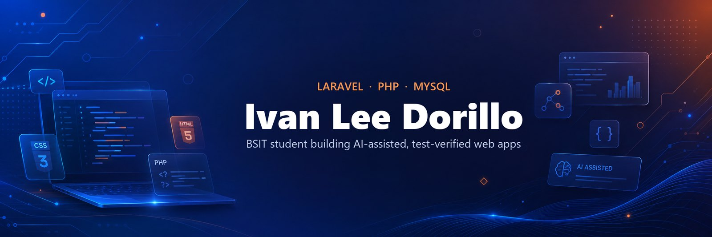
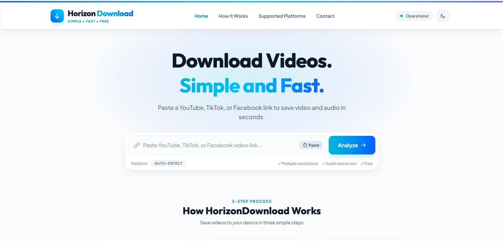
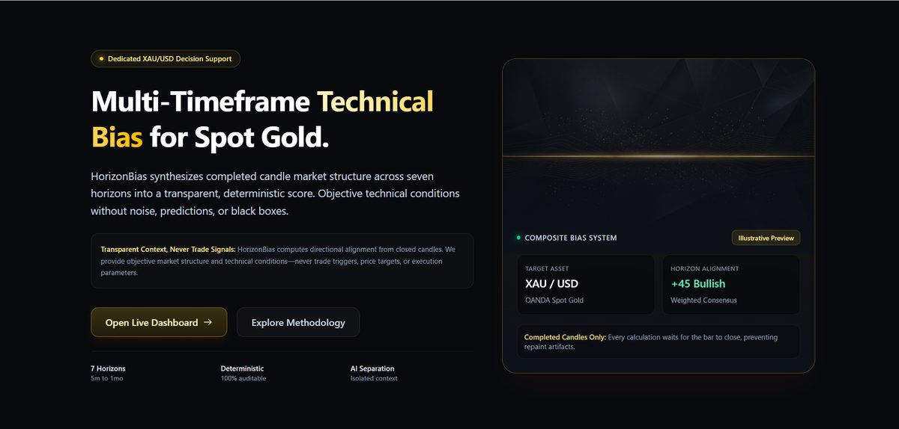
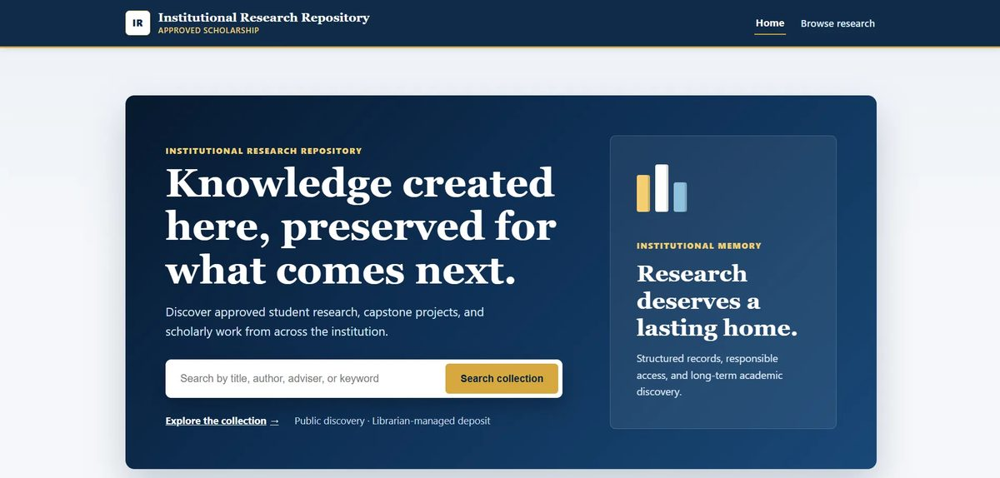

  <a href="https://dorillo-portfolio.xo.je/"><b>Portfolio</b></a> ·
  <a href="https://www.linkedin.com/in/ivan-lee-dorillo-0585aa426/"><b>LinkedIn</b></a> ·
  <a href="mailto:ivanleedorillo@gmail.com"><b>Email</b></a>

I'm a third-year BSIT student at Baliuag Polytechnic College in the Philippines. I build Laravel and PHP web apps with AI coding tools, and I check what the AI writes with automated tests and my own code review.

**Open to:** web development internships (Laravel · PHP · MySQL) and project collaboration.

## Featured work

<table>
  <tr>
    <td colspan="2">
      

### [HorizonDownload](https://github.com/ivanleedorillo-ops/HorizonDownload)

A Laravel 12 media downloader for public YouTube, TikTok, and Facebook links. It prepares files in a supervised background queue, merges HD video and audio with FFmpeg, and delivers them through short-lived download tickets.

**222 PHPUnit tests · 90 Playwright browser runs · SSRF-safe URL validation**

`Laravel 12` `PHP 8.2` `Alpine.js` `MySQL` `FFmpeg` `Playwright` · [Live showcase →](https://ivanleedorillo-ops.github.io/HorizonDownload/)

  </td>
  </tr>
  <tr>
    <td width="50%" valign="top">
      

### [HorizonBias](https://github.com/ivanleedorillo-ops/HorizonBias)

A gold (XAU/USD) market dashboard. It scores seven timeframes with indicators calculated in PHP, has two AI models review macro news separately, and lets Laravel, not the AI, decide the consensus. Exports PDF and Word reports.

**Deterministic, auditable scoring · no trade signals**

`Laravel 12` `PHP` `Alpine.js` `MySQL`

  </td>
    <td width="50%" valign="top">
      

### [ResearchVault](https://github.com/ivanleedorillo-ops/ResearchVault)

My capstone project: a research repository for schools. Librarians upload and manage approved studies; students browse, search, and download them without an account.

**Capstone · in development**

`Laravel` `PHP` `MySQL` `Blade`

  </td>
  </tr>
</table>

**More:** [PHP Learning Journey](https://github.com/ivanleedorillo-ops/PHP-Learning-Journey) (lesson-by-lesson PHP practice, [live](https://ivanleedorillo-ops.github.io/PHP-Learning-Journey/)) · [Ohana Biz](https://ohanabiz.xo.je/index.php) (team project: clients track their service requests) · [Corner Cravings](https://github.com/rheywindarantan-web/Corner-Cravings) (team restaurant site I contributed to) · [Portfolio site source](https://github.com/ivanleedorillo-ops/Dorillo-Portfolio)

## How I build

- **AI drafts, tests decide.** I plan and generate code with AI tools, then review it and keep it only when the tests pass. In HorizonDownload and HorizonBias, tests use mocked services and never call real APIs.
- **Security from the start.** Input validation, rate limits, Content Security Policy, and secrets kept out of Git.
- **Clear limits.** I write down what an app does not do: HorizonBias states plainly that it gives no trade advice, and HorizonDownload has a responsible-use policy.

## Toolbox

  

Also: PHPUnit, Playwright, Vite, XAMPP. Currently learning: database design, Laravel queues, and deployment.

## Let's connect

I'm happy to talk about internships, projects, or web development in general.

[LinkedIn](https://www.linkedin.com/in/ivan-lee-dorillo-0585aa426/) · [Email](mailto:ivanleedorillo@gmail.com) · [Portfolio](https://dorillo-portfolio.xo.je/) · [Facebook](https://web.facebook.com/ivanlee.dorillo)

Build · Test · Learn · Improve
